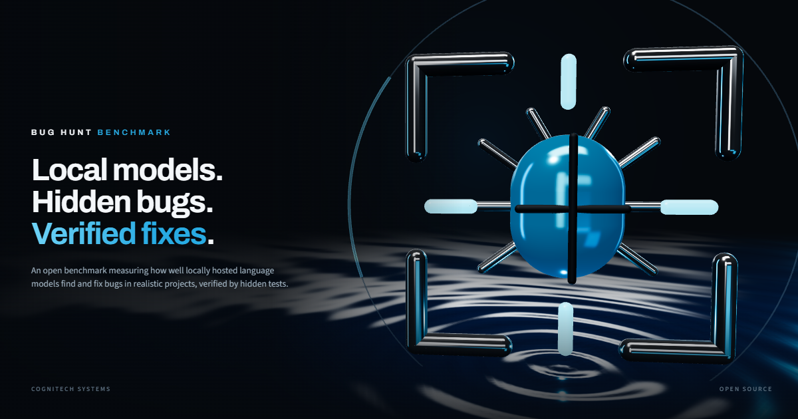
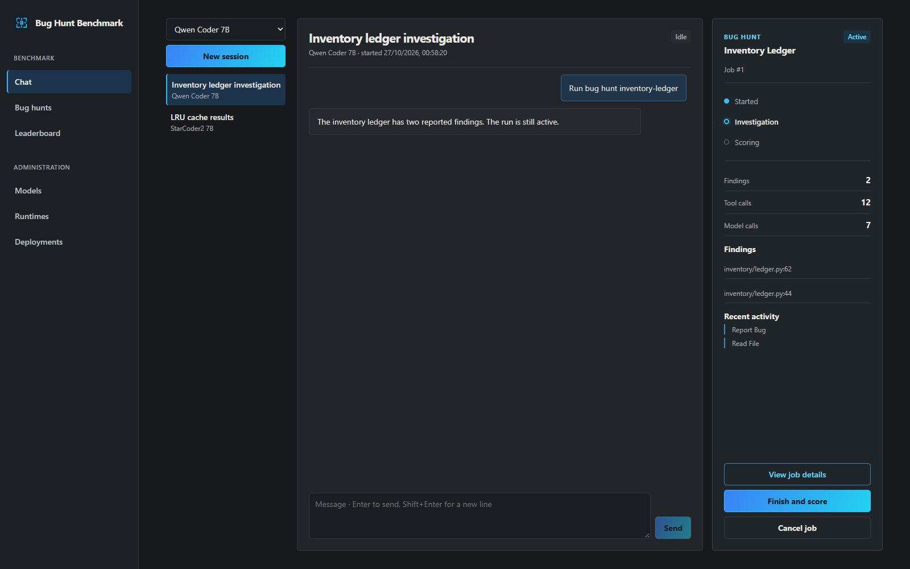
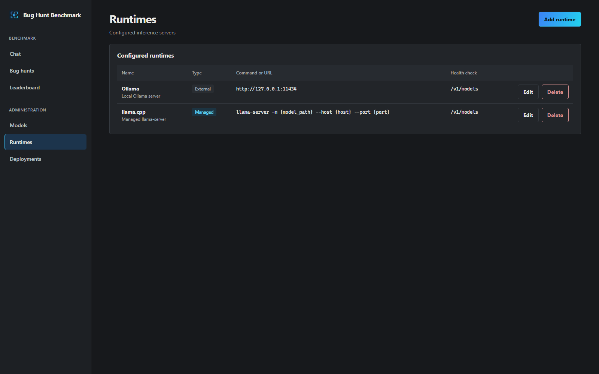
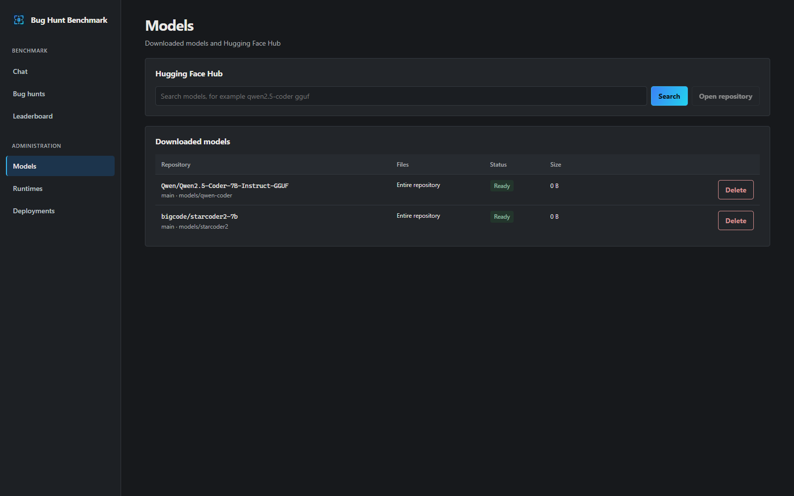
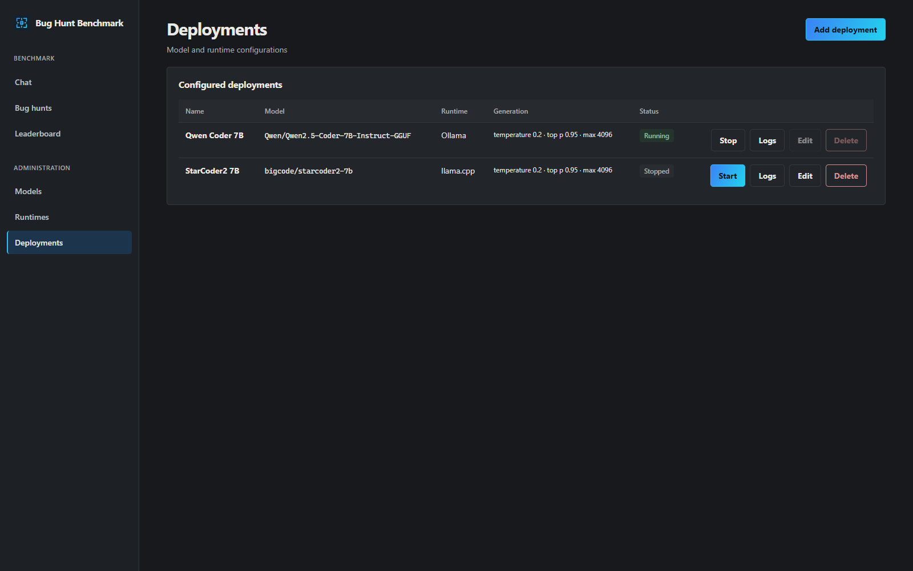
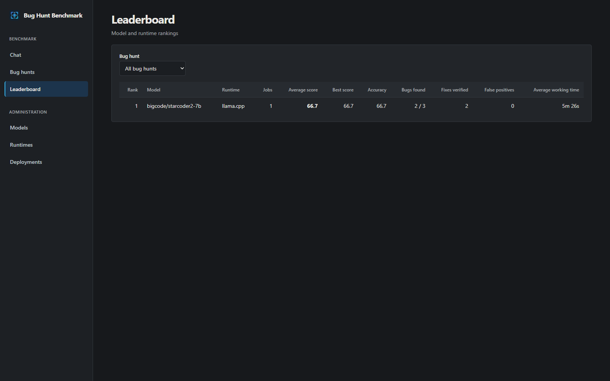
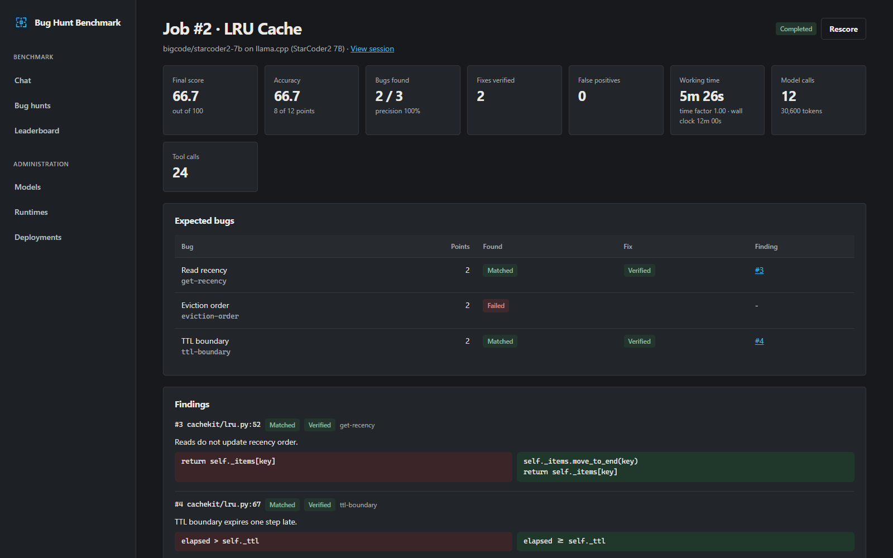
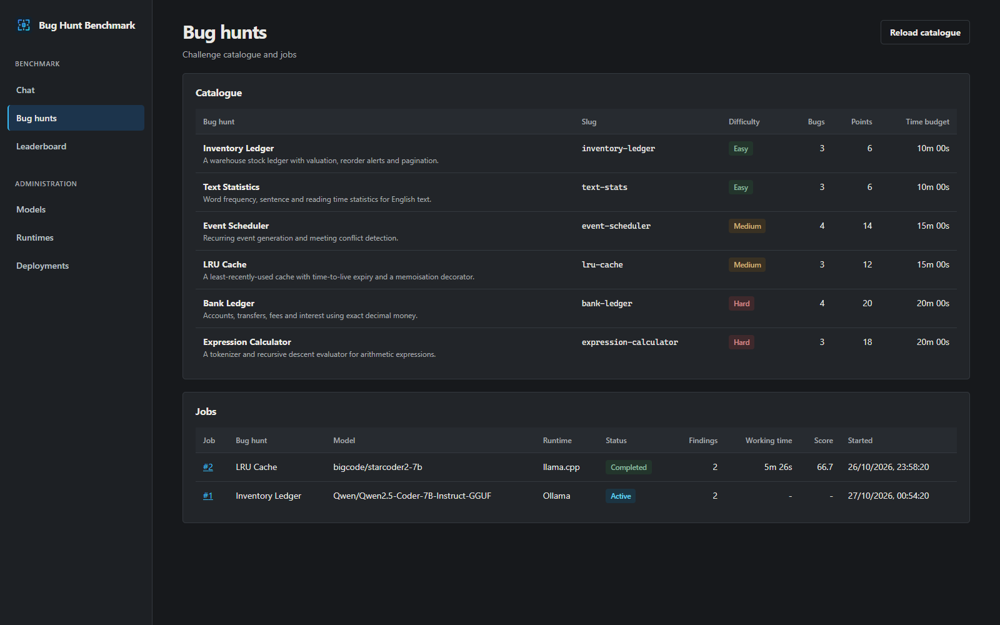

# Bug Hunt Benchmark

Benchmark locally hosted language models on real debugging work.

Model videos and articles often focus on chat responses. That is a limited basis for choosing
a model to integrate into a system. Bug Hunt Benchmark lets you run the same debugging tasks
against locally hosted models and compare verified results before making that decision.

Bug Hunt Benchmark is a browser application for downloading models from the Hugging Face Hub,
serving them with inference runtimes such as Strata, llama.cpp, vLLM, SGLang, Ollama or
LM Studio, and measuring how well each model finds and fixes deliberate defects in a set of
small projects.

You talk to a deployed model in the chat and ask it to run a bug hunt, for example
"Run bug hunt inventory-ledger". The model then:

1. starts a bug hunt job, which is recorded against the model, runtime and deployment settings,
2. reads the project through sandboxed tools,
3. reports each defect with a proposed fix,
4. finishes the hunt, after which every proposed fix is verified against hidden tests and the
   job is scored.

Every conversation, tool call, finding and score is stored in the database.

Screenshots below use sample data.

## Contents

- [Requirements](#requirements)
- [Installation](#installation)
- [Running the application](#running-the-application)
- [Installing runtimes](#installing-runtimes)
- [Workflow](#workflow)
- [Scoring](#scoring)
- [Bug hunts](#bug-hunts)
- [Configuration](#configuration)
- [Development](#development)
- [Project structure](#project-structure)
- [Branding assets](#branding-assets)

## Requirements

| Component | Version | Notes |
| --- | --- | --- |
| Python | 3.11 or later | Runs the backend and the hidden test suites. |
| Node.js | 20 or later | Only needed to build the frontend. |
| A runtime | See [Installing runtimes](#installing-runtimes) | Must expose an OpenAI-compatible chat completions API with tool calling. |

Supported platforms are Windows 10 and 11, Windows Subsystem for Linux 2 (WSL) and Linux.

## Installation

### Windows (PowerShell)

```powershell
git clone https://github.com/CogniTechSystems/bugs-benchmark.git
cd bugs-benchmark
.\scripts\setup.ps1
```

If script execution is disabled, run
`powershell -ExecutionPolicy Bypass -File .\scripts\setup.ps1` instead.

### Linux and WSL (bash)

```bash
git clone https://github.com/CogniTechSystems/bugs-benchmark.git
cd bugs-benchmark
bash scripts/setup.sh
```

On Debian and Ubuntu, install `python3-venv` first if it is missing:
`sudo apt install python3-venv`.

The setup scripts create a virtual environment in `backend/.venv`, install the backend and
build the frontend into `frontend/dist`. Pass `-SkipFrontend` (PowerShell) or
`--skip-frontend` (bash) to install only the backend.

### Sharing one checkout between Windows and WSL

When the repository lives on a Windows drive and is used from WSL through `/mnt/<drive>`,
the bash scripts automatically keep the WSL virtual environment in
`~/.venvs/bug-hunt-benchmark` and the data directory in
`~/.local/share/bug-hunt-benchmark`. This avoids conflicts with the Windows virtual
environment and the unreliable SQLite file locking on Windows mounts. Override either location
with `BHB_VENV` and `BHB_DATA_DIR`.

The built frontend is platform independent, so it only needs to be built once. `npm ci`
replaces `node_modules` with platform-specific binaries, so on a shared checkout run it from
one environment only and use `--skip-frontend` in the other.

## Running the application

```powershell
.\scripts\start.ps1        # Windows
```

```bash
bash scripts/start.sh      # Linux and WSL
```

Open <http://127.0.0.1:8000>. The database is created and migrated automatically on first
start.

To reach the interface from another machine, set `BHB_HOST=0.0.0.0`. The application has no
authentication, so only do this on a trusted network.



## Installing runtimes

A runtime is any server that implements the OpenAI chat completions API, including tool
calling. Runtimes are added as entries on the **Administration > Runtimes** page and come in
two kinds:

- **Managed**: the application launches the server from a command template when a deployment
  starts, captures its output into the database and stops it on request.
- **External**: the server is already running, and the application connects to its base URL.

The runtime form includes presets for each of the runtimes below. Install the runtime first
using its official documentation, then add the entry.



| Runtime | Kind | Platforms | Model format | Official documentation |
| --- | --- | --- | --- | --- |
| Strata | External | Windows | Managed by Strata | Provided with the Strata installation |
| llama.cpp | Managed | Windows, Linux, WSL | GGUF file | [Installation](https://github.com/ggml-org/llama.cpp/blob/master/docs/install.md), [server](https://github.com/ggml-org/llama.cpp/tree/master/tools/server), [function calling](https://github.com/ggml-org/llama.cpp/blob/master/docs/function-calling.md) |
| vLLM | Managed | Linux, WSL | Safetensors repository | [Installation](https://docs.vllm.ai/en/latest/getting_started/installation/), [tool calling](https://docs.vllm.ai/en/latest/features/tool_calling.html) |
| SGLang | Managed | Linux, WSL | Safetensors repository | [Installation](https://docs.sglang.ai/get_started/install.html), [tool parser](https://docs.sglang.ai/advanced_features/tool_parser.html) |
| Ollama | External | Windows, Linux, WSL | Managed by Ollama | [Download](https://ollama.com/download), [OpenAI compatibility](https://docs.ollama.com/api/openai-compatibility) |
| LM Studio | External | Windows, Linux | Managed by LM Studio | [Download](https://lmstudio.ai/download), [local server](https://lmstudio.ai/docs/developer) |

### Strata

Strata exposes an OpenAI-compatible API on `http://127.0.0.1:47831` while it is running.

1. Add a runtime from the **Strata (external)** preset.
2. On the **Models** page, enter a repository ID for the model loaded in Strata and choose
   **Register only**. Strata manages its own model files, so nothing is downloaded.
3. Create a deployment with the **Served model name** set to the Strata model ID, for
   example `iq3_s`. The available IDs are listed at `http://127.0.0.1:47831/v1/models`.

### llama.cpp

Install a release build, for example with `winget install llama.cpp` on Windows or
`brew install llama.cpp` on Linux, or build from source as described in the installation
guide. Make sure `llama-server` is on `PATH`, or put its full path in the command template.

Download a GGUF repository, selecting a single quantisation file, and pick that file as the
**Model file** of the deployment. The preset command passes `--jinja`, which llama.cpp
requires for native tool calling. Add GPU offloading with the deployment's extra launch
arguments, for example `-ngl 99`.

### vLLM and SGLang

Both run on Linux only, so on Windows run them and this application inside WSL. Install them
into their own virtual environment as described in their documentation, and make sure the
`vllm` command, or the `python` interpreter that has SGLang installed, is on `PATH` when you
start the application. Download the full safetensors repository and leave **Model file** set
to the entire model directory. Choose the tool call parser that matches the model family; the
presets use `hermes` for vLLM and `qwen25` for SGLang.

### Ollama and LM Studio

These manage their own model storage. Register the model on the **Models** page with
**Register only**, and set the deployment's **Served model name** to the model name the
runtime uses, for example `qwen2.5-coder:7b` for Ollama. Ollama can also pull models
directly from the Hub, for example `ollama pull hf.co/Qwen/Qwen2.5-Coder-7B-Instruct-GGUF:Q4_K_M`.

### Command templates

Managed runtime commands may use these placeholders:

| Placeholder | Value |
| --- | --- |
| `{model_path}` | The deployment's model file, or the model directory if no file is selected. |
| `{model_dir}` | The model's download directory. |
| `{host}` | The host the runtime should bind to (`BHB_RUNTIME_HOST`). |
| `{port}` | A free port chosen when the deployment starts. |
| `{served_model_name}` | The deployment's served model name, or the repository ID. |

Arguments are split using the quoting rules of the host platform before placeholders are
substituted, so paths containing spaces are passed correctly. Wrap executable paths that
contain spaces in double quotes.

## Workflow

1. **Models**: search the Hugging Face Hub, choose the files to download and track download
   progress. Set `BHB_HF_TOKEN` to access gated repositories.
2. **Runtimes**: add an entry for each installed runtime.
3. **Deployments**: pair a model with a runtime, choose the model file, launch arguments and
   generation settings, then start it. Runtime output is shown on the same page.
4. **Chat**: start a session with a running deployment and ask the model to run a bug hunt,
   for example "Run bug hunt bank-ledger". Tool calls and their results appear inline. The
   active job can also be finished or cancelled from the chat.
5. **Bug hunts**: browse the catalogue and every job run so far.
6. **Job details**: the score breakdown, every finding with its outcome and fix verification
   result, and the settings the job was run with.
7. **Leaderboard**: completed jobs aggregated per model and runtime.

**Models**



**Deployments**



**Leaderboard**



### Agent tools

| Tool | Purpose |
| --- | --- |
| `list_bug_hunts` | List the available bug hunts. |
| `start_bug_hunt` | Start a job and return the project's file list. |
| `list_files`, `read_file`, `search_code` | Inspect the project. Access is limited to the project's source directory. |
| `report_bug` | Record a defect: file, line, explanation, the original code and its replacement. |
| `finish_bug_hunt` | Close the job and submit the findings for scoring. |

The model never sees the hidden tests or the expected answers.

## Scoring

When a job finishes, the scorer evaluates every finding:

1. **Matching.** A finding matches an expected bug when it names the same file and its line
   falls within the bug's line range, widened by `BHB_LINE_TOLERANCE` lines on each side.
   If several findings match the same bug, only the most recent one is scored; the earlier
   ones are marked as superseded and are not penalised. Findings that match no bug are false
   positives.
2. **Fix verification.** Each matched finding's replacement is applied to a pristine copy of
   the project and the hidden test suite is run. The fix is verified when the bug's own tests
   pass and every test unrelated to any expected bug still passes. Fixes are applied exactly
   when possible, with a whitespace-tolerant fallback that re-indents the replacement.
3. **Points.** Each bug is worth its points for detection and the same again for a verified
   fix. Each false positive deducts `BHB_FALSE_POSITIVE_PENALTY` points. The total cannot go
   below zero.
4. **Accuracy** is the percentage of available points earned.
5. **Time.** Time is working time: the total duration of the job's model calls and tool
   executions. Waiting for the user, or for a runtime that has failed, is not counted. The
   wall-clock duration is recorded as well. Each bug hunt has a time budget. Within the budget
   the time factor is 1.0; beyond it the factor is `budget / working time`, never lower than
   `BHB_MINIMUM_TIME_FACTOR`. Budgets are sized for local models on consumer GPUs, which
   commonly generate a few tokens per second while reasoning: 30 minutes for easy hunts,
   45 minutes for medium and 60 minutes for hard.
6. **Final score** is accuracy multiplied by the time factor, out of 100.

Precision, recall, model calls, tool calls and token usage are recorded alongside the score.
Jobs can be rescored from the job page, for example after changing the scoring settings.



## Bug hunts

| Slug | Difficulty | Bugs | Description |
| --- | --- | --- | --- |
| `inventory-ledger` | Easy | 3 | Stock valuation, reorder alerts and pagination. |
| `text-stats` | Easy | 3 | Word frequencies, sentence counts and reading time. |
| `event-scheduler` | Medium | 4 | Recurring dates and meeting conflict detection. |
| `lru-cache` | Medium | 3 | LRU eviction, recency and time-to-live expiry. |
| `bank-ledger` | Hard | 4 | Decimal money, transfers, fees and interest. |
| `expression-calculator` | Hard | 3 | Tokenizer and recursive descent evaluator. |



### Adding a bug hunt

Create a directory under `challenges/` named after the slug:

```text
challenges/my-hunt/
├── challenge.toml   # metadata and expected bugs
├── src/             # code given to the agent
└── tests/           # hidden pytest suite
```

```toml
title = "My Hunt"
difficulty = "medium"          # easy, medium or hard
language = "python"
time_budget_seconds = 2700
summary = "One line shown in the catalogue."

[[bugs]]
key = "unique-key"
title = "Short description of the defect"
file = "package/module.py"     # relative to src/
points = 2
tests = ["tests/test_module.py::test_behaviour"]
original = '''
    return a - b
'''
replacement = '''
    return a + b
'''
```

The `original` snippet must occur exactly once in the file; the bug's line range is derived
from it. Then choose **Reload catalogue** on the **Bug hunts** page, or restart the
application.

The test suite in `backend/tests/test_challenges.py` checks every bug hunt:

- each bug's tests fail on the shipped code,
- every other test passes,
- each reference fix repairs its own bug without regressions,
- all fixes together pass the whole suite,
- the source contains no comments that could hint at the defects.

## Configuration

Settings are read from environment variables prefixed with `BHB_`, or from a `.env` file in
the repository root. See [.env.example](.env.example).

| Variable | Default | Description |
| --- | --- | --- |
| `BHB_DATA_DIR` | `./data` | Database and downloaded models. |
| `BHB_DATABASE_URL` | SQLite in the data directory | Any SQLAlchemy URL. For PostgreSQL, install the `postgres` extra and use `postgresql+psycopg://...`. |
| `BHB_HOST`, `BHB_PORT` | `127.0.0.1`, `8000` | Address of the web application. |
| `BHB_HF_TOKEN` | Not set | Hugging Face access token. |
| `BHB_RUNTIME_HOST` | `127.0.0.1` | Host that managed runtimes bind to. |
| `BHB_AGENT_MAX_ITERATIONS` | `60` | Maximum model calls per chat message. |
| `BHB_TOOL_OUTPUT_LIMIT` | `20000` | Maximum characters returned by a tool. |
| `BHB_LINE_TOLERANCE` | `2` | Line tolerance when matching findings. |
| `BHB_FALSE_POSITIVE_PENALTY` | `0.5` | Points deducted per false positive. |
| `BHB_MINIMUM_TIME_FACTOR` | `0.5` | Lowest time factor applied to overdue jobs. |
| `BHB_SCORING_TIMEOUT_SECONDS` | `120` | Timeout for each hidden test run. |

### Networking between Windows and WSL

When the application and a runtime run on different sides of the WSL boundary, `127.0.0.1`
may not reach the other side. Enable
[mirrored networking](https://learn.microsoft.com/windows/wsl/networking#mirrored-mode-networking)
in WSL, or use the other side's IP address in the external runtime's base URL.

## Development

Run the backend with automatic reload and the frontend development server in two terminals:

```bash
cd backend
.venv/bin/uvicorn app.main:app --reload          # Windows: .venv\Scripts\uvicorn app.main:app --reload
```

```bash
cd frontend
npm run dev
```

The development server runs on <http://127.0.0.1:5173> and proxies `/api` to the backend.
Set `BHB_BACKEND_URL` to proxy to another address.

### Quality checks

```bash
cd backend
.venv/bin/python -m pytest      # tests, including challenge integrity
.venv/bin/ruff check app tests migrations
.venv/bin/ruff format --check app tests migrations
.venv/bin/mypy app
```

```bash
cd frontend
npm run typecheck
npm run lint
npm run build
```

### Database migrations

The schema is managed with Alembic and upgraded automatically at startup. After changing
the models in `backend/app/models`, create a migration from the `backend` directory:

```bash
.venv/bin/alembic revision --autogenerate -m "Describe the change"
```

Review the generated file before committing it.

### API

The REST API is served under `/api`. Interactive documentation is available at
<http://127.0.0.1:8000/docs> while the application is running.

## Project structure

```text
backend/
  app/
    api/            REST endpoints
    models/         SQLAlchemy models
    schemas/        Request and response schemas
    services/
      agent/        System prompt, tools and the agent turn loop
      challenges.py Challenge catalogue loader
      code_edits.py Locating and applying proposed fixes
      huggingface.py Hub search and downloads
      runtime_manager.py Runtime process management
      scoring.py    Finding matching, fix verification and scoring
      test_runner.py Isolated execution of hidden tests
  migrations/       Alembic migrations
  tests/
challenges/         Bug hunt projects
frontend/           React and TypeScript user interface
scripts/            Setup and start scripts for PowerShell and bash
```

## Branding assets

Ready-to-use images are in [assets/branding](assets/branding), all rendered from a single
three.js scene, [banner.html](assets/branding/banner.html), which also runs as a live animated
banner. The set includes 1280×720 and 1200×630 social cards, square and portrait posts, a
story image, X and LinkedIn headers, and a profile mark. See the
[asset list](assets/branding/README.md) for exact dimensions.

## Licence

Released under the GNU Affero General Public License v3.0. See [LICENSE](LICENSE).
